<picture>
  <source media="(prefers-color-scheme: dark)" srcset="assets/hero-dark.svg">
  <source media="(prefers-color-scheme: light)" srcset="assets/hero-light.svg">
  
</picture>

**Computer Science and Engineering student at IIT Bhilai.** I like to find out what a system really does underneath,
in the process table, on the wire or in the control plane. Then I build something and measure whether it works.

Contributor to **Kubernetes** (kubeadm, kubelet, cli-runtime) · building **Saans**, WiFi sensing on ESP32 with a Rust gateway.

## About

- **I build** backends, pipelines and agents that have to run unattended: a crawler across 35 government portals,
  a policy gate that can veto a money action, a gateway that turns WiFi signal into a picture of someone's day.
- **I explore** Linux and process supervision, networking and load balancing, and what Kubernetes components do
  when something they expect is missing.
- **I care about** claims that come with evidence: a ground truth, a control arm, a test that fails before the fix.

## Featured work

### [Saans](https://github.com/devreddy1015/areu_there) &nbsp;WiFi sensing for elder care · [site](https://devreddy1015.github.io/areu_there/)

Tells a family that a parent living alone is all right, from the WiFi already in the home: presence, movement and
breathing from channel state information, with no camera and nothing to wear. ESP32-S3 nodes run the DSP in C++ and
send 68-byte feature frames, so raw CSI never leaves the room. A Rust gateway fuses the links, runs health detectors
and serves the dashboard.

**Why it's interesting:** one pipeline in three languages, kept in step by golden vectors. The Rust DSP reproduces the
standard-library-only Python reference byte for byte. Status is stated plainly: everything so far runs in simulation,
and no board has run the firmware yet.

`Rust` `C++` `ESP32-S3` `Python` `DSP`

### [Control Arm](https://github.com/devreddy1015/payment_recovery) &nbsp;payment-failure recovery agent · [demo](https://payment-recovery-one.vercel.app/)

Takes failed recurring payments in India (UPI AutoPay, eMandate, cards, payment links), classifies each failure by
rail, proposes a bounded recovery action, and executes only what a policy gate allows. Every gate rule cites the RBI,
NPCI or TCCCPR instrument it comes from.

**Why it's interesting:** it ships with its own counterfactual. Recovery is measured per rail against Razorpay's
documented behaviour, with paired bootstrap intervals over 30 seeds and nine machine-checked invariants. The README
leads with the rail where it *loses*, and explains why.

`Python` `pydantic` `Hypothesis` `Anthropic API`

### [TenderLens](https://github.com/devreddy1015/tenderlens) + [DocIntel](https://github.com/devreddy1015/docintel) &nbsp;public-procurement search · [live](https://tenderlens-inky.vercel.app)

TenderLens finds open tenders across 35 official NIC GePNIC portals and makes them searchable, with typo tolerance,
facets and an India map, on Postgres full-text search and `pg_trgm`. DocIntel reads the tender documents. It answers
with citations to the page and refuses when the documents don't support an answer.

**Why it's interesting:** hybrid retrieval (pgvector HNSW + BM25 + a cross-encoder reranker), with answering *and*
refusing both measured by its own benchmark.

`Django REST Framework` `React` `PostgreSQL` `FastAPI` `pgvector` `Elasticsearch`

### [AYTO](https://github.com/devreddy1015/ayto-qloo) &nbsp;Qloo Agentic Hackathon · [live](https://ayto-ocx1.onrender.com) · [video](https://youtu.be/pM4jVRt6DUc)

Say what you're making and where. AYTO plans its Qloo taste-data reads for that format, finds what the city loves
and isn't getting, and writes the brief with the LLM you bring (12 providers supported).

**Why it's interesting:** the agent audits itself. Every name it writes is checked against the Qloo evidence and
rewritten if it can't be traced. A *with vs without Qloo* card runs the same model with no evidence to show the
difference. It is also an MCP server that other agents can call.

`Node.js` `Express` `MCP` `Remotion`

<b>Also built</b>

 

- **[group_chat](https://github.com/devreddy1015/group_chat)**: real-time chat across three backends behind a Go
  load balancer. It picks backends by measured load, skips unhealthy ones, and its threshold was tuned with a
  purpose-built load generator. *Team project.*
- **[watchdog](https://github.com/devreddy1015/watchdog)**: a C++ process supervisor: `fork`/`execvp`, crash
  detection with `waitpid`, memory trends from `/proc/<pid>/status`, restart limits.
- **[Handscript](https://github.com/devreddy1015/hand_plag)**: typed text, PDF or DOCX into realistic handwriting,
  entirely in the browser. The importer rebuilds lines, columns and lists from raw PDF glyph runs.
  [live](https://devreddy1015.github.io/hand_plag/)
- **[api-migration-agent](https://github.com/devreddy1015/api-migration-agent)**: an LLM agent that migrates v1→v2
  API code using a retrieved guide. The first guide did *worse* than no guide, and the traces showed why.
  *Team capstone.*
- **[JustInTimeFarm2Home](https://github.com/Galabavamsi/CSL559_CSD_Group_Project)**: farm-to-home hubs on FastAPI
  and PostGIS. My part was the platform: Docker Compose, staff auth and roles, rate limiting, an audit log,
  Prometheus and Grafana. *Team course project.*

## Stack

Only what appears in the code above or in merged upstream work.

- **Languages**: Python · TypeScript / JavaScript · Go · Rust · C++
- **Backend & frontend**: FastAPI · Django REST Framework · Express · React
- **Systems & infra**: Linux · Docker Compose · systemd · ESP32-S3 firmware · Prometheus · Grafana · GitHub Actions
- **Networking**: WiFi CSI sensing · load balancing and health checks · WebSockets
- **Data**: PostgreSQL (full-text, `pg_trgm`, pgvector, PostGIS) · Elasticsearch · SQLite
- **AI / LLM**: Anthropic API · MCP · hybrid retrieval and reranking · sentence-transformers · evaluation harnesses
- **Tools**: Git · pytest · Hypothesis · Playwright · Make · uv

## Open source

**[Kubernetes](https://github.com/kubernetes/kubernetes/pulls?q=is%3Apr+author%3Adevreddy1015)**

- kubeadm: `upgrade plan` panicked when no kube-apiserver Pod was found; now it returns a clear error.
  [#143628](https://github.com/kubernetes/kubernetes/pull/143628), backported to 1.35, 1.36 and 1.37
- kubeadm: the "run `kubeadm init phase certs ca`" hint for missing CA files was lost in a refactor; restored.
  [#143557](https://github.com/kubernetes/kubernetes/pull/143557), backported to 1.35, 1.36 and 1.37
- kubeadm: the version-policy error printed the cluster's version as the minimum supported one.
  [#143629](https://github.com/kubernetes/kubernetes/pull/143629)
- kubelet: `kubelet_runtime_operations_errors_total` now exists from startup, so error-rate alerts see zero
  instead of a missing series. Carried a stalled PR through to merge. [#143827](https://github.com/kubernetes/kubernetes/pull/143827)
- cli-runtime: some kubectl messages for objects in named API groups broke onto two lines.
  [#143558](https://github.com/kubernetes/kubernetes/pull/143558)
- In review: client-go event aggregation keeps the reporting controller ([#143559](https://github.com/kubernetes/kubernetes/pull/143559)),
  keyutil reports an empty or invalid key file instead of `<nil>` ([#143829](https://github.com/kubernetes/kubernetes/pull/143829)),
  and docs for kubeadm patches in sub-directories ([website#59263](https://github.com/kubernetes/website/pull/59263)).

**Elsewhere**

- [davinci-resolve-mcp](https://github.com/samuelgursky/davinci-resolve-mcp/pull/392): word-highlight outlines,
  a highlight box and layout controls for captions. Merged.
- [archinstall](https://github.com/archlinux/archinstall/pulls?q=is%3Apr+author%3Adevreddy1015): two fixes to the
  Arch Linux installer's menus. In review.
- [rea](https://github.com/morluto/rea/pull/7166): keyed-archive dates when the offset table reaches the trailer.
  In review. An earlier fix of mine ([#7171](https://github.com/morluto/rea/pull/7171)) landed through the
  maintainer's broader [#12161](https://github.com/morluto/rea/pull/12161).

## Currently exploring

- **kubeadm and the kubelet**: reading the code behind the errors users hit, then fixing them upstream.
- **Saans on real hardware**: taking the pipeline off the simulator and onto ESP32-S3 boards.
- **Tools for small, local models**: MCP servers that a model running on Ollama can drive reliably.
- **Arch Linux internals**, starting with its installer.

## Activity

Pull requests outside my own repos, as live GitHub searches:
[merged in Kubernetes](https://github.com/kubernetes/kubernetes/pulls?q=is%3Apr+author%3Adevreddy1015+is%3Amerged) ·
[all upstream PRs](https://github.com/search?q=author%3Adevreddy1015+is%3Apr+-user%3Adevreddy1015&type=pullrequests).
The contribution graph below is GitHub's own.

## Contact

[rahuldevreddy.vercel.app](https://rahuldevreddy.vercel.app) ·
[LinkedIn](https://www.linkedin.com/in/rahul-dev-reddy) ·
[devreddy8125@gmail.com](mailto:devreddy8125@gmail.com)
